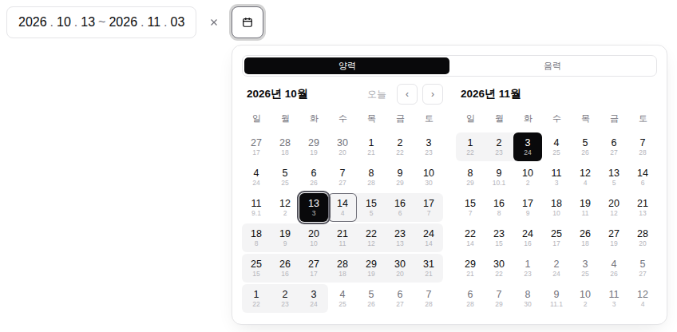

# lunisolar-picker

React date pickers that let users enter Korean lunar (음력) dates, leap months and 30th days included, and store them in Temporal's calendar format: `'2026-10-14[u-ca=dangi]'`.

[](https://www.npmjs.com/package/@lunisolar-picker/react)
[](https://github.com/kubrickcode/lunisolar-picker/actions/workflows/ci.yml)
[](LICENSE)

**[Documentation](https://kubrickcode.github.io/lunisolar-picker/)** · [Getting started](https://kubrickcode.github.io/lunisolar-picker/getting-started/) · [Lunar calendar guide](https://kubrickcode.github.io/lunisolar-picker/guides/lunar-calendar/) · [Changelog](packages/react/CHANGELOG.md)

<picture>
  <source media="(prefers-color-scheme: dark)" srcset=".github/assets/date-range-picker-dark.png">
  
</picture>

## Features

- **Lunar input, not just a lunar label.** Switch a picker to lunar mode and users pick the lunar date itself. Leap months (윤달) appear only in the years that have them, and day 30 only in 30-day months.
- **Temporal-format values.** A lunar entry keeps its solar day and adds `[u-ca=dangi]`, the annotation `Temporal.PlainDate.from` reads. You can still sort and compare by day, and you still know the user entered a lunar date.
- **KASI data, the same answer on server and phone.** The lunar table is generated from the Korea Astronomy and Space Science Institute (KASI) API and tested against every published month, lunar 1900–2050. It does not use the `Intl` Korean calendar. Off until you import it, about 2 KB gzipped when you do.

Without the lunar calendar it is still a complete date picker kit:

- **Six pickers**: date, date range, month, wheel date, wheel time and time.
- **Mouse, keyboard and touch.** Popovers on desktop, bottom sheets on phones. Follows the WAI-ARIA date picker patterns.
- **Strings in, strings out.** Values are canonical strings (`'2026-10-14'`, `'14:30'`) that compare with `===`, survive URLs and forms, and parse with Temporal.
- **Headless core.** State lives in a framework-agnostic core; React parts render it, so you can rebuild any picker from the same parts.
- **Themeable.** A monochrome theme in its own cascade layer, dark mode, and a bridge to shadcn/ui tokens.
- **Server rendering.** Works with Next.js server components, Vite and Astro.

## Install

```sh
pnpm add @lunisolar-picker/react @lunisolar-picker/core @lunisolar-picker/calendar @lunisolar-picker/theme
```

Requires React 19 and an ESM-capable bundler. Server rendering needs Node 22.12 or later.

## Quick start

Load the theme once in your global CSS:

```css
@layer theme, base, lunisolar-picker, components, utilities;
@import '@lunisolar-picker/theme/mono.css';
```

Render a picker:

```tsx
import type { DateString } from '@lunisolar-picker/calendar';
import { DatePicker } from '@lunisolar-picker/react/pickers';
import { useState } from 'react';

export function DueDate() {
  const [value, setValue] = useState<DateString | null>(null);
  return <DatePicker aria-label="Due date" value={value} onValueChange={(next) => setValue(next)} />;
}
```

## Korean lunar dates

Pass `dangi` to `calendars`. Pickers then show a solar/lunar toggle and a lunar date under each day.

```tsx
import { dangi } from '@lunisolar-picker/calendar/dangi';
import { LunisolarProvider } from '@lunisolar-picker/react';

const calendars = [dangi];

<LunisolarProvider calendars={calendars}>…</LunisolarProvider>;
```

A date entered in lunar mode keeps its solar day and records how it was entered, the format Temporal uses: `'2026-10-14[u-ca=dangi]'`.

When a lunar date stops existing while the user scrolls a wheel or moves through a calendar, the picker moves it to the nearest one: a leap month that the new year lacks becomes the regular month, and day 30 becomes day 29. Typed input is never changed; the field reports `'invalid-date'` instead. In a date field, <kbd>L</kbd> toggles the leap month.

Lunar dates cover lunar 1 January 1900 to lunar 30 November 2050 (solar 12 January 2051), the end of the published KASI data. See the [lunar calendar guide](https://kubrickcode.github.io/lunisolar-picker/guides/lunar-calendar/).

## Pickers

| Picker | Value |
|---|---|
| [`DatePicker`](https://kubrickcode.github.io/lunisolar-picker/pickers/date-picker/) | `'2026-10-14'` |
| [`DateRangePicker`](https://kubrickcode.github.io/lunisolar-picker/pickers/date-range-picker/) | `{ start: '2026-10-01', end: '2026-10-31' }` |
| [`MonthPicker`](https://kubrickcode.github.io/lunisolar-picker/pickers/month-picker/) | `'2026-10'` |
| [`WheelDatePicker`](https://kubrickcode.github.io/lunisolar-picker/pickers/wheel-date-picker/) | `'2026-10-14'` |
| [`WheelTimePicker`](https://kubrickcode.github.io/lunisolar-picker/pickers/wheel-time-picker/) | `'14:30'` |
| [`TimePicker`](https://kubrickcode.github.io/lunisolar-picker/pickers/time-picker/) | `'14:30'` |

Need something props can't express? Build your own from the [parts and hooks](https://kubrickcode.github.io/lunisolar-picker/guides/customizing-pickers/).

## Packages

| Package | Contents |
|---|---|
| [`@lunisolar-picker/react`](packages/react) | React hooks, parts and finished pickers. |
| [`@lunisolar-picker/core`](packages/core) | Framework-agnostic picker state, constraints, grids and locales (`en`, `ko`, `ja`). |
| [`@lunisolar-picker/calendar`](packages/calendar) | Date values, Gregorian and Korean lunar calendars. No dependencies. |
| [`@lunisolar-picker/theme`](packages/theme) | The Mono theme and the shadcn/ui token bridge. |

All four are released together with the same version.

## Contributing

Issues and pull requests are welcome. See [CONTRIBUTING.md](CONTRIBUTING.md) for the development setup, and [SECURITY.md](SECURITY.md) to report a vulnerability.

## License

[MIT](LICENSE) © kubrickcode

---

### 한국어 소개

사용자가 한국 음력 날짜를 직접 고를 수 있는 React date picker입니다. 윤달은 윤달이 있는 해에만 목록에 나오고, 30일은 30일까지 있는 달에서만 고를 수 있습니다. 음력으로 입력한 날짜는 `'2026-10-14[u-ca=dangi]'`처럼 Temporal 형식으로 저장되어, 양력 날짜와 "음력으로 입력했다"는 사실이 함께 남습니다.

음력 표는 한국천문연구원(KASI) 음양력 OpenAPI 자료로 만들었고 음력 1900년 1월 1일부터 2050년 11월 30일까지 지원합니다. 브라우저 `Intl`의 한국 음력을 쓰지 않으므로 서버와 휴대폰이 같은 음력 날짜를 보여 줍니다. `dangi`를 import하기 전에는 번들에 들어가지 않습니다.

음력을 켜지 않아도 날짜·기간·월·휠·시간 picker, 키보드와 터치 입력, 모바일 바텀시트, 서버 렌더링, shadcn/ui 토큰 연결을 그대로 쓸 수 있습니다. 한국어 로캘은 `@lunisolar-picker/core/locales/ko`에서 가져옵니다.
