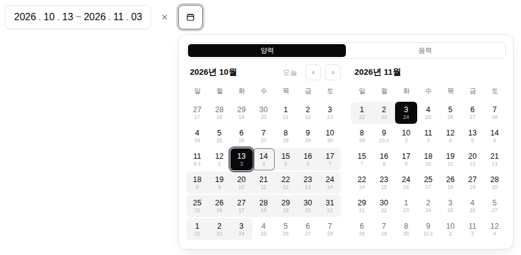

# lunisolar-picker

Modern, accessible date pickers for React, with optional Korean lunisolar (음력) calendar support.

[](https://www.npmjs.com/package/@lunisolar-picker/react)
[](https://github.com/kubrickcode/lunisolar-picker/actions/workflows/ci.yml)
[](LICENSE)

**[Documentation](https://kubrickcode.github.io/lunisolar-picker/)** · [Getting started](https://kubrickcode.github.io/lunisolar-picker/getting-started/) · [Lunar calendar guide](https://kubrickcode.github.io/lunisolar-picker/guides/lunar-calendar/) · [Changelog](packages/react/CHANGELOG.md)

<picture>
  <source media="(prefers-color-scheme: dark)" srcset=".github/assets/date-range-picker-dark.png">
  
</picture>

## Features

- **Six pickers**: date, date range, month, wheel date, wheel time and time.
- **Mouse, keyboard and touch.** Popovers on desktop, bottom sheets on phones. Follows the WAI-ARIA date picker patterns.
- **Strings in, strings out.** Values are canonical strings (`'2026-10-14'`, `'14:30'`) that compare with `===`, survive URLs and forms, and parse with Temporal.
- **Headless core.** State lives in a framework-agnostic core; React parts render it, so you can rebuild any picker from the same parts.
- **Korean lunar dates.** Leap months and 30th days from KASI data (lunar 1900–2050). Off until you import it, about 2.5 KB gzipped when you do.
- **Themeable.** A monochrome theme in its own cascade layer, dark mode, and a bridge to shadcn/ui tokens.
- **Server rendering.** Works with Next.js server components, Vite and Astro.

## Install

```sh
pnpm add @lunisolar-picker/react @lunisolar-picker/core @lunisolar-picker/calendar @lunisolar-picker/theme
```

Requires React 19 and an ESM-capable bundler. Server rendering needs Node 22.12 or later.

## Quick start

Load the theme once in your global CSS:

```css
@layer theme, base, lunisolar-picker, components, utilities;
@import '@lunisolar-picker/theme/mono.css';
```

Render a picker:

```tsx
import type { DateString } from '@lunisolar-picker/calendar';
import { DatePicker } from '@lunisolar-picker/react/pickers';
import { useState } from 'react';

export function DueDate() {
  const [value, setValue] = useState<DateString | null>(null);
  return <DatePicker aria-label="Due date" value={value} onValueChange={(next) => setValue(next)} />;
}
```

## Korean lunar dates

Pass `dangi` to `calendars`. Pickers then show a solar/lunar toggle and a lunar date under each day.

```tsx
import { dangi } from '@lunisolar-picker/calendar/dangi';
import { LunisolarProvider } from '@lunisolar-picker/react';

const calendars = [dangi];

<LunisolarProvider calendars={calendars}>…</LunisolarProvider>;
```

A date entered in lunar mode keeps its solar day and records how it was entered, the format Temporal uses: `'2026-10-14[u-ca=dangi]'`. See the [lunar calendar guide](https://kubrickcode.github.io/lunisolar-picker/guides/lunar-calendar/).

## Pickers

| Picker | Value |
|---|---|
| [`DatePicker`](https://kubrickcode.github.io/lunisolar-picker/pickers/date-picker/) | `'2026-10-14'` |
| [`DateRangePicker`](https://kubrickcode.github.io/lunisolar-picker/pickers/date-range-picker/) | `{ start: '2026-10-01', end: '2026-10-31' }` |
| [`MonthPicker`](https://kubrickcode.github.io/lunisolar-picker/pickers/month-picker/) | `'2026-10'` |
| [`WheelDatePicker`](https://kubrickcode.github.io/lunisolar-picker/pickers/wheel-date-picker/) | `'2026-10-14'` |
| [`WheelTimePicker`](https://kubrickcode.github.io/lunisolar-picker/pickers/wheel-time-picker/) | `'14:30'` |
| [`TimePicker`](https://kubrickcode.github.io/lunisolar-picker/pickers/time-picker/) | `'14:30'` |

Need something props can't express? Build your own from the [parts and hooks](https://kubrickcode.github.io/lunisolar-picker/guides/customizing-pickers/).

## Packages

| Package | Contents |
|---|---|
| [`@lunisolar-picker/react`](packages/react) | React hooks, parts and finished pickers. |
| [`@lunisolar-picker/core`](packages/core) | Framework-agnostic picker state, constraints, grids and locales (`en`, `ko`, `ja`). |
| [`@lunisolar-picker/calendar`](packages/calendar) | Date values, Gregorian and Korean lunar calendars. No dependencies. |
| [`@lunisolar-picker/theme`](packages/theme) | The Mono theme and the shadcn/ui token bridge. |

All four are released together with the same version.

## Contributing

Issues and pull requests are welcome. See [CONTRIBUTING.md](CONTRIBUTING.md) for the development setup, and [SECURITY.md](SECURITY.md) to report a vulnerability.

## License

[MIT](LICENSE) © kubrickcode

---

### 한국어 소개

양력 날짜 선택을 기본으로 하고, 필요할 때 한국 음력(윤달·30일 포함) 입력을 켤 수 있는 React 날짜 picker 라이브러리입니다. 음력 데이터는 한국천문연구원(KASI) 자료로 만들었고, `dangi`를 import하기 전에는 번들에 들어가지 않습니다. 한국어 로캘은 `@lunisolar-picker/core/locales/ko`에서 가져옵니다.
